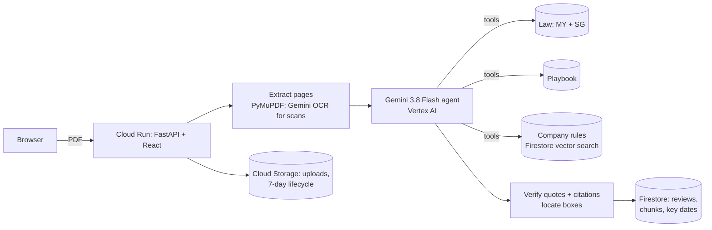

# Contract Co-pilot

**Know what you're signing — before you sign it.**

Contract Co-pilot reviews the vendor contracts that small businesses in Malaysia and Singapore sign
without a lawyer. Upload an NDA or a service agreement. In under a minute you see the contract's own
pages, with every risky clause boxed on the exact words. For each one you get what it means in plain
English, what a balanced version looks like, the Malaysian or Singapore law or case that applies, any
conflict with your company's own contracting rules, and a reply to the vendor that is ready to send.

Built for the Google Cloud **AI Builder Cup 2026**, under the theme *Future of Work & Enterprise Productivity*.

> Contract Co-pilot gives general information to help you prepare. It is not legal advice.

## What it does

- **Reads any PDF**, including scanned, image-only contracts and contracts in Bahasa Malaysia.
- **Reviews like an advisor, not a chatbot.** A Gemini agent plans its lookups, then checks each clause
  against a standard-terms playbook, a verified library of Malaysian and Singapore law, and your company's
  uploaded policies.
- **Every claim is verified.** A finding is shown only if its quote is found on the stated page. A
  citation is shown only if it comes from the knowledge base, with its text copied from the source.
- **Shows the evidence on the page**, with highlight boxes on the real PDF.
- **Tracks the dates that matter**, such as the last day to cancel before an auto-renewal.
- **Drafts the negotiation email**, with one ask per issue, each tied to its clause and page.
- **Searches** across every contract you have reviewed.

## Architecture



| Layer | Google Cloud |
|---|---|
| Model | Gemini 3.8 Flash on Vertex AI (global endpoint); `gemini-embedding-2` for search |
| App | Cloud Run (scales to zero, max 3 instances) |
| Data | Firestore with vector search; Cloud Storage |
| Infrastructure as code | Pulumi (Python): `infrastructure/gcp` with bootstrap, foundation and app stacks, a budget, alerts, an uptime check, labels |

## Repository layout

```
services/api/        Python backend: pipeline, agent, adapters (GCP and local), tests
web/                 React + TypeScript frontend
shared/contracts/    JSON Schema for the API, the single source of truth for api and web
knowledge/law/       Malaysian and Singapore statutes and cases, each with its source URL
knowledge/playbook/  standard terms per clause type, for NDAs and service agreements
samples/             synthetic contracts with answer keys, plus a sample company policy
eval/results/        measured eval runs
infrastructure/gcp/  Pulumi stacks
scripts/             review, eval, seed, deploy, teardown
```

## Run it locally

```bash
cd services/api && uv sync
CLOUD=local LLM=fake uv run pytest -q             # offline tests
CLOUD=local LLM=vertex uv run python ../../scripts/review.py ../../samples/contracts/msa-02-autorenew.pdf
cd ../../web && npm ci && npm run dev             # http://localhost:5173, proxies /api
```

Real reviews need Google Cloud application-default credentials with access to Vertex AI.

## Deploy

```bash
bash infrastructure/gcp/bootstrap.sh              # project, billing link, state bucket
source infrastructure/gcp/env.sh
(cd infrastructure/gcp/foundation && pulumi up)   # APIs, IAM, registry, budget, alerts
bash scripts/deploy.sh                            # build, pulumi up app, health check
```

## Data

All sample contracts and the company policy are synthetic: invented companies, no real people.
The law library quotes official sources (Laws of Malaysia, Singapore Statutes Online, eLitigation).
The source of each entry is listed in `knowledge/law/README.md`.
