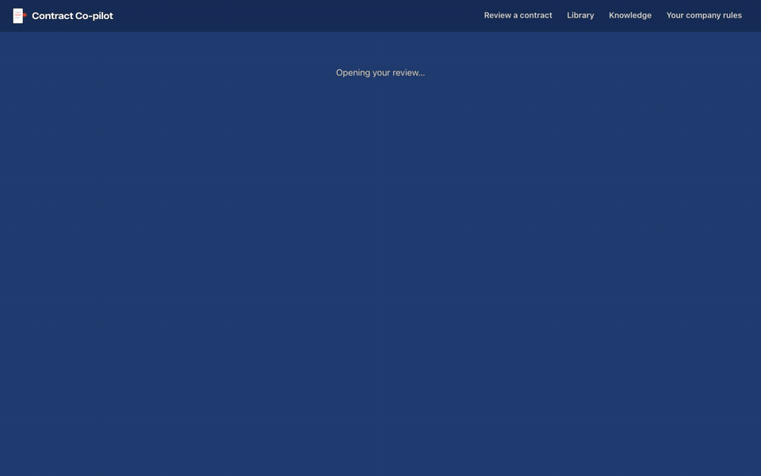
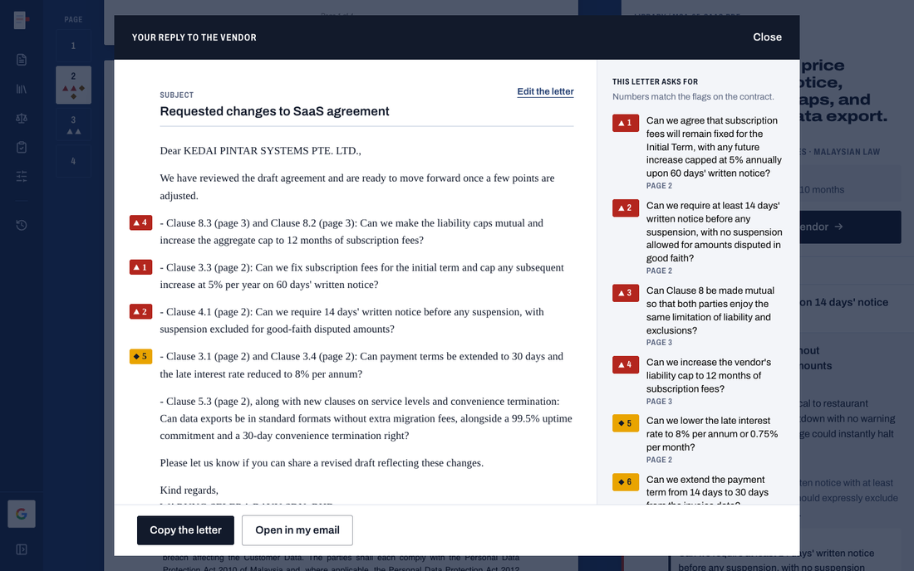
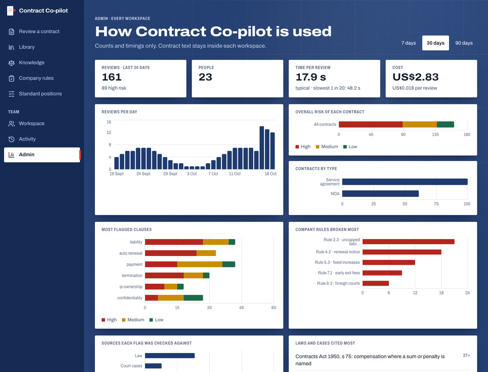
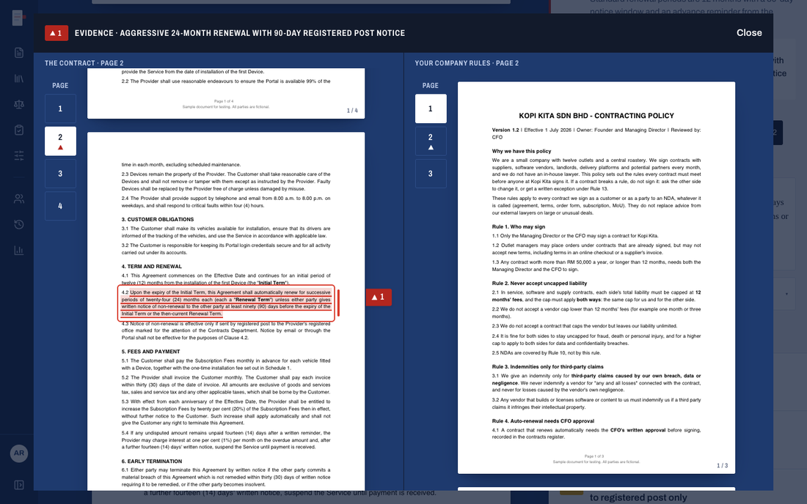
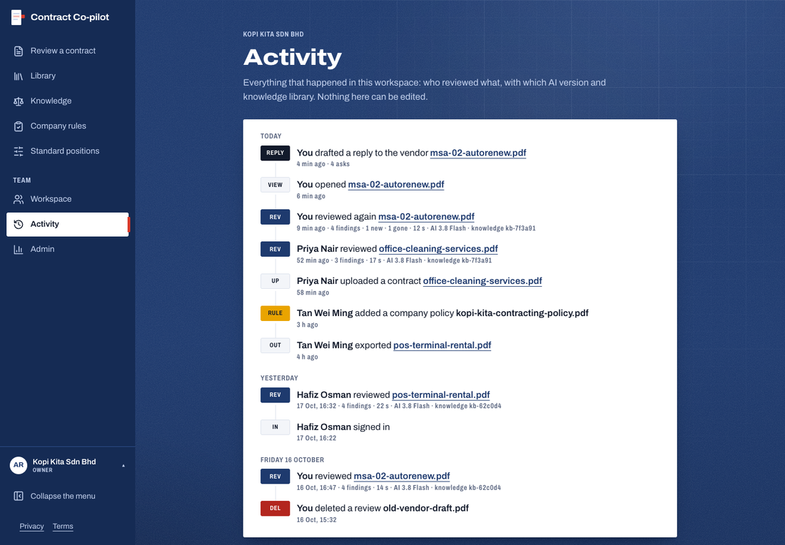
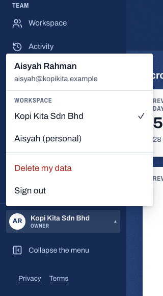
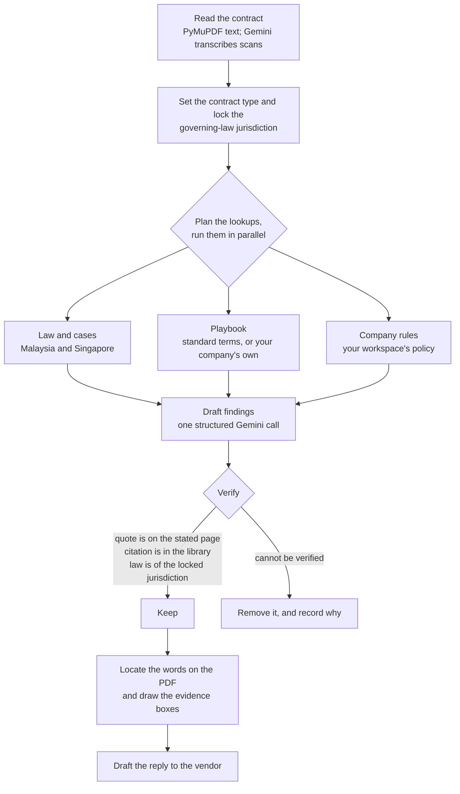
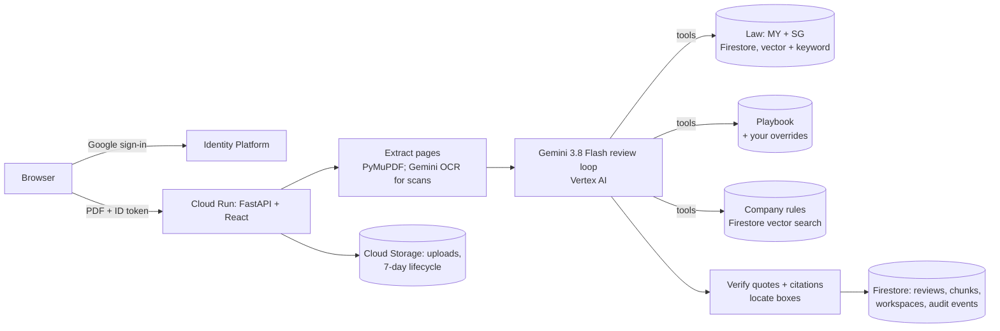

<div align="center">


# Contract Co-pilot

**Know what you're signing, before you sign it.**

Contract Co-pilot reviews the vendor contracts that small businesses in Malaysia and Singapore sign without a lawyer.
Upload a PDF and read the contract's own pages with every risky clause boxed on the exact words, what each one
means in plain English, the law that applies, and a reply to the vendor that is ready to send.

[](https://cloud.google.com)
[](https://cloud.google.com/vertex-ai)
[](https://cloud.google.com/run)
[](https://cloud.google.com/firestore)
[](infrastructure/gcp)
[](services/api)
[](web)

**[Open the live demo](https://contract-copilot-ordg3tjh7a-as.a.run.app)** · built for the Google Cloud **AI Builder Cup 2026**, theme *Future of Work & Enterprise Productivity*

</div>

> Contract Co-pilot gives general information to help you prepare. It is not legal advice.

## See it work

Watch the 3-minute demo: [watch on Google Drive](https://drive.google.com/file/d/1KztL52YcRw1_XKTOd6A3fr5pkWpoL8yx/view).

A software subscription agreement, reviewed. Each coloured box sits on the words in the vendor's PDF; the panel explains the clause,
shows what a balanced term looks like, and quotes the company rule it breaks.

<p align="center"></p>

One click turns the findings into a reply to the vendor, with one ask per issue, each tied to its clause and page.

<p align="center"></p>

## What you get

| | |
|---|---|
| **A reader, not a report.** Boxes are drawn on the real PDF, on the exact words, so you can check every claim yourself. |  |
| **Citations that are real.** Each finding links Malaysian or Singapore law, or a case, taken from a library where every entry keeps its source URL and the quoted text. |  |
| **Your own rules, applied.** Upload your company's contracting policy once (owners and admins do this). Reviews flag the clauses that break it and quote the rule. |  |
| **Dates that matter.** The last day to cancel before an auto-renewal, and other deadlines, collected across your contracts. |  |
| **Search every contract your company has reviewed.** Describe the situation in your own words and get the clause and its page. Results blend meaning (vector) with exact words and phrases (keyword). |  |
| **A reply ready to send.** One ask per issue, numbered to match the flags on the contract. Edit it, copy it, or open it in your email. |  |

Also: it reads scanned, image-only PDFs and contracts written in Bahasa Malaysia, and explains them in English.

### Teams, accounts and trust

The public demo needs no login: anyone can open the sample reviews, draft a reply, search and browse the law library. Uploading
a contract or a policy, and deleting anything, needs sign-in.

The screens below show a signed-in workspace, with sample data: a made-up company ("Kopi Kita Sdn Bhd"), invented people and invented contracts.

<table>
<tr>
<td width="50%"><br><sub><b>Dashboards, aggregates only.</b> Usage, risk mix, flagged clauses and citations. Counts and timings, never contract text.</sub></td>
<td width="50%"><br><sub><b>Evidence, side by side.</b> The boxed clause in the contract next to the company rule it is checked against.</sub></td>
</tr>
<tr>
<td width="50%"><br><sub><b>An audit trail.</b> Who did what and when, with the model and knowledge-base version on each review.</sub></td>
<td width="50%" align="center"><br><sub><b>Workspaces and your data.</b> Switch workspace, delete your data, sign out.</sub></td>
</tr>
</table>

| | |
|---|---|
| **Google sign-in.** Google Cloud Identity Platform; the API checks every ID token against the project. | `GET /api/me`, `GET /api/auth/config` |
| **A workspace per company.** The first person from a Google Workspace domain creates the company workspace; later colleagues from that domain join it. A Gmail user gets a personal workspace. Reviews, policies and search never cross workspaces. | `/api/workspaces` |
| **Roles and invites.** Owner, admin and member. Owners and admins invite (a code valid for 7 days), change roles, remove people and manage company policies and standard positions; members review, search, draft and upload contracts. | `/api/workspaces/{id}/invites`, `/api/invites/{code}/accept` |
| **Your standard positions.** Edit what a balanced clause means for your company, per contract type and clause. The review checks against your version and says so. | `/api/playbook` |
| **An audit trail.** Every upload, review, re-review, reply, view, export and delete is recorded (who, what, when, which model and knowledge-base version). It holds metadata, never contract text. Owners and admins see the whole workspace; a member sees their own. | `/api/activity` |
| **Review provenance and history.** Each review records the model, the knowledge-base version, the prompt version and the app version, and a hash of the PDF. Reviewing the same document again links to the earlier run. | `/api/reviews/{id}/history` |
| **Your data, deletable.** Delete a review, or everything you own. | `DELETE /api/reviews/{id}`, `POST /api/me/delete` |
| **Dashboards, aggregates only.** Owners and admins see their workspace's usage, risk mix, citations, cost and deadlines. Platform administrators see the same across all workspaces, plus the audit metadata, and never any contract text. | `/api/workspaces/{id}/overview`, `/api/admin/*` |

## How it works



The loop is bounded: two model turns and at most 16 lookups per review. The first turn plans every lookup at once, so they run
side by side instead of one after another.

**Three rules decide what you see.** A finding is shown only if its quote is found on the page it names. A citation is shown only
if it comes from the knowledge library, with its text copied from the source and never written by the model. And the law cited
is that of the contract's governing jurisdiction: it is fixed once, early in the review, and a citation from the other
jurisdiction is removed. Anything that fails a check is removed from the result and recorded with the review as a "removed
claim" with the reason, so you can see what the model said and why it was not shown.

## Measured results

The newest evaluation run (`eval/results/20261018T075234Z`, model `gemini-3.8-flash`) reviewed **all 25 synthetic contracts** in
the repository against a hand-written answer key: 6 NDAs, 10 service agreements, and 3 each of employment, tenancy and hire
purchase. Four are in Bahasa Malaysia and one is a scan. The contracts are invented, so treat this as a regression check on a
small set, not as a claim about real-world accuracy.

| Measure | Result |
|---|---|
| Expected issues found | **61 of 76 (80%)**: 44 of 54 high risk, 17 of 22 medium |
| Issues the review reported | 105 findings in total |
| False highs (a high flag on a clause the key says is not high) | **0** |
| Contract type read correctly | 25 of 25 |
| Overall risk label matches the key | 23 of 25 (one called high where the key says medium, one medium where it says high) |
| Time per review, median / slowest | 23.3 s / 50.4 s |
| LLM cost per review, mean | $0.0221 (embeddings excluded, about $0.001 more) |
| Claims removed by verification | 3 of 248 claims made (1.2%); all 3 were findings, no citation was removed |
| Reviews that errored | 0 of 25 |

By contract type, expected issues found:

| Contract type | Contracts | Found |
|---|---|---|
| NDA | 6 | 15 of 18 |
| Service agreement | 10 | 22 of 31 |
| Employment and freelance | 3 | 8 of 9 |
| Tenancy | 3 | 7 of 9 |
| Hire purchase | 3 | 9 of 9 |
| **The three newer packs** | 9 | **24 of 27** |
| **NDA and service agreement** | 16 | **37 of 49** |

The counts are small (three contracts per newer pack), so the gap between the two groups is not a finding. The weak spots are
visible in the run's clause table: data protection (0 of 2) and governing law (0 of 2) were not found, and termination was found
in 6 of 10.

<p align="center"></p>

**What changed since the first full run.** The same 25 contracts were run earlier the same day (`20261018T072735Z`): 23 reviews
completed and 2 errored because the AI service did not respond, 53 of 67 expected issues found, 3 false highs, median 21.7 s,
slowest 161.6 s, $0.0202 per review. On the 23 contracts that completed both times, the expected issues found went from 53 to
52 of 67, so the fixes did not raise recall. What they changed: the 3 false highs are gone, two contract-type misreads
(`emp-03-freelance-bm`, `hp-03-personal-loan`) are read correctly, and all 25 reviews now complete.

**The earlier 8-contract check.** The first scored run (`20261018T045101Z`) covered only the 4 NDAs and 4 service agreements
that existed then: 20 of 20 expected issues found, 3 false highs, median 17.9 s, slowest 62.6 s, $0.0176 per review. On those
same 8 contracts the newest run finds 19 of 20 (it misses the governing-law issue in `nda-03-predatory`), with no false highs.
Timing depends on how busy the model endpoint is. All runs are kept in [`eval/results`](eval/results).
Reproduce a run with `scripts/eval.py` (see below).

## Coverage

| Contract type | Standard-terms notes | Sample contracts | Of which Bahasa Malaysia |
|---|---|---|---|
| NDA | 10 | 6 | 1 |
| Service agreement | 12 | 10 | 1 |
| Employment and freelance | 11 | 3 | 1 |
| Tenancy | 10 | 3 | 1 |
| Hire purchase | 10 | 3 | 0 |
| **Total** | **53** | **25** | **4** |

**Jurisdictions:** Malaysia and Singapore. The review picks one from the governing-law clause.

**Law library:** 96 entries, each with its source URL.

| | Statutes | Cases | Total |
|---|---|---|---|
| Malaysia | 40 | 2 | 42 |
| Singapore | 38 | 16 | 54 |

Contract types are packs: a set of standard terms, the relevant law, and samples with answer keys. The reader, the verification
and the reply are shared, so adding a type is mostly content. See [`docs/public/roadmap.md`](docs/public/roadmap.md).

## Architecture



Cloud services sit behind adapters chosen by one environment variable, so the review logic imports no cloud SDK and the whole
pipeline runs offline in tests.

| Layer | Google Cloud |
|---|---|
| Model | Gemini 3.8 Flash on Vertex AI (global endpoint); `gemini-embedding-2` for search |
| App | Cloud Run: scales to zero, at most 3 instances |
| Data | Firestore with vector search (reviews, search chunks, company policies, workspaces and members, invites, users, audit events, the knowledge library, standard-position overrides); Cloud Storage with a 7-day lifecycle on uploads |
| Sign-in | Google Cloud Identity Platform (Google as the only provider); the API verifies each ID token and serves the web client config at `/api/auth/config` |
| Operations | Cloud Monitoring alerts (5xx rate, latency, uptime check), a Cloud Billing budget, labels on every resource |
| Infrastructure as code | Pulumi (Python) in [`infrastructure/gcp`](infrastructure/gcp): bootstrap script, `foundation` stack, `app` stack |

Limits on the public URL: PDFs up to 10 MB and 40 pages, 10 reviews per hour per address.

## Repository layout

```
services/api/        Python backend: pipeline, review loop, adapters (GCP and local), tests
web/                 React + TypeScript frontend
shared/contracts/    JSON Schema for the API, the single source of truth for api and web
knowledge/law/       Malaysian and Singapore statutes and cases, each with its source URL
knowledge/playbook/  standard terms per clause type, for each contract type
samples/             synthetic contracts with answer keys, plus a sample company policy
eval/results/        measured evaluation runs
infrastructure/gcp/  Pulumi stacks
scripts/             review, eval, seed, deploy, teardown
docs/public/         images for this README, and the roadmap
```

## Run it locally

```bash
cd services/api && uv sync
CLOUD=local LLM=fake uv run pytest -q             # offline tests
CLOUD=local LLM=vertex uv run python ../../scripts/review.py ../../samples/contracts/msa-02-autorenew.pdf
CLOUD=local LLM=vertex uv run python ../../scripts/eval.py   # score the samples; writes eval/results
cd ../../web && npm ci && npm run dev             # http://localhost:5173, proxies /api
```

Real reviews need Google Cloud application-default credentials with access to Vertex AI. With `CLOUD=local` the API accepts
test tokens (`Authorization: Bearer test:<uid>:<email>`, optionally `:hd=<domain>`) instead of Identity Platform ID tokens; they
are rejected on a deployed service.

## Deploy

```bash
bash infrastructure/gcp/bootstrap.sh              # project, billing link, state bucket
source infrastructure/gcp/env.sh
(cd infrastructure/gcp/foundation && pulumi up)   # APIs, IAM, registry, budget, alerts
bash scripts/deploy.sh                            # build, pulumi up app, health check
```

Google sign-in switches on once the Google OAuth client id and secret are set in the `app` stack config (`googleClientId`,
`googleClientSecret`); platform administrators are listed in the secret config `adminEmails`. `scripts/ingest_knowledge.py
--target gcp` indexes the law and playbook into Firestore. `scripts/teardown.sh` removes what the deploy created.

## Data and licences

- Every sample contract and the sample company policy is synthetic: invented companies, no real people.
- The law library quotes official sources (Laws of Malaysia, Singapore Statutes Online, eLitigation). The source and reuse terms
  of each entry are listed in [`knowledge/law/README.md`](knowledge/law/README.md); playbook sources are in
  [`knowledge/playbook/SOURCES.md`](knowledge/playbook/SOURCES.md).
- This repository does not yet include a software licence file. Until one is added, all rights in the code are reserved.

## Disclaimer

Contract Co-pilot gives general information to help you prepare for a conversation with the other side. It is not legal advice,
and it does not replace a lawyer for a contract that matters.
