<div align="center">

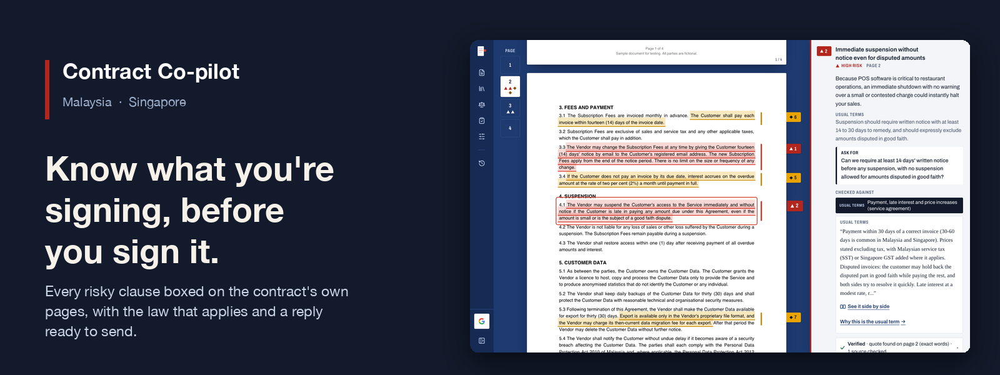

# Contract Co-pilot

**Know what you're signing, before you sign it.**

Reviews the contracts small businesses in Malaysia and Singapore sign without a lawyer: NDAs, service agreements,
employment, tenancy and hire purchase. Each risky clause is boxed on the contract's own page, with the law that
applies, your company's rules, and a reply you can edit.

[](https://cloud.google.com)
[](https://cloud.google.com/vertex-ai)
[](https://cloud.google.com/run)
[](https://cloud.google.com/firestore)
[](infrastructure/gcp)
[](services/api)
[](web)

**[Open the live demo](https://contract-copilot-ordg3tjh7a-as.a.run.app)** · built for the Google Cloud **AI Builder Cup 2026**, theme *Future of Work & Enterprise Productivity*

</div>

> Contract Co-pilot gives general information to help you prepare. It is not legal advice.

## Why it matters

A café owner signing a POS subscription, a freelancer signing a client's terms, a tenant signing a shoplot lease:
most sign without a lawyer. The clauses that hurt are ordinary ones: a renewal that stops only with 90 days'
notice, a price that can rise without limit, a liability cap that protects only the other side.

## See it work

**[Watch the 3-minute demo video](https://drive.google.com/file/d/1KztL52YcRw1_XKTOd6A3fr5pkWpoL8yx/view)** (recorded on an earlier version of the interface).

Select a finding and the contract scrolls to its boxed words; the X-ray shows every lookup the review made.

<p align="center">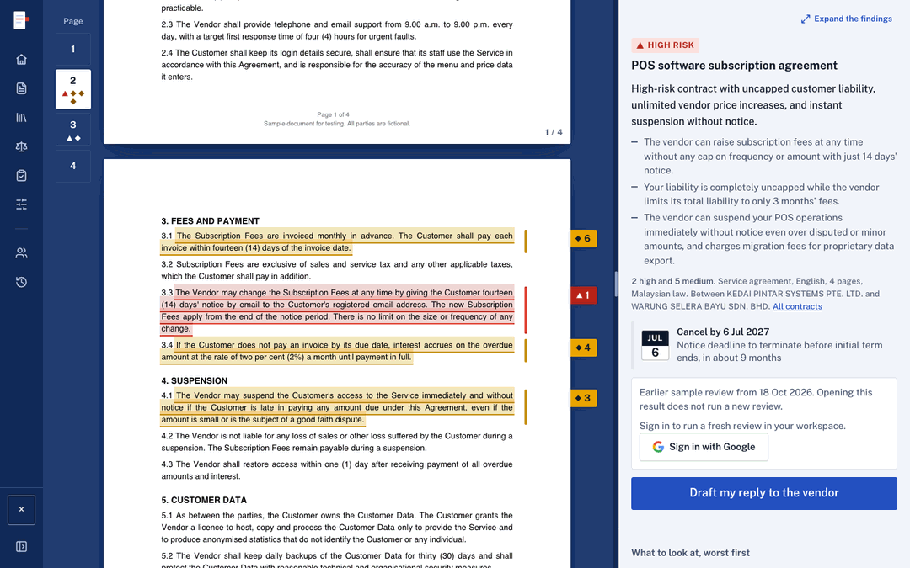</p>

Pick a sample, read its pages first, then open its saved review. No sign-in needed.

<p align="center">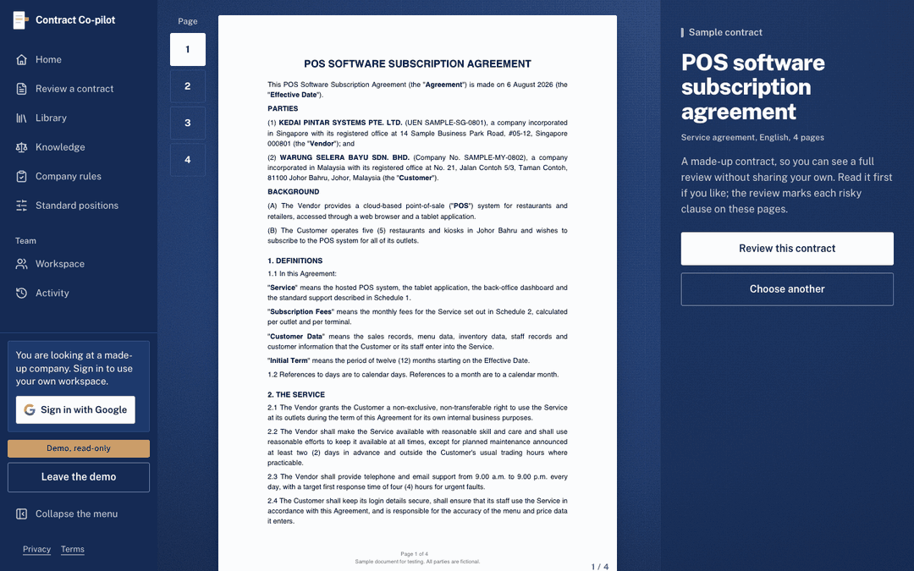</p>

Or open **Workspace → View the read-only demo** to explore the fictional Kopi Kita company. Saved reviews,
keyword search and the law library need no sign-in.

## What you get

| | |
|---|---|
| **The contract beside the findings.** The real PDF, with each quoted clause boxed and numbered. A short summary, the verdict and the next deadline sit beside it. |  |
| **Your company's rules, applied.** Upload your contracting policy once. Findings quote the rule a clause breaks. | 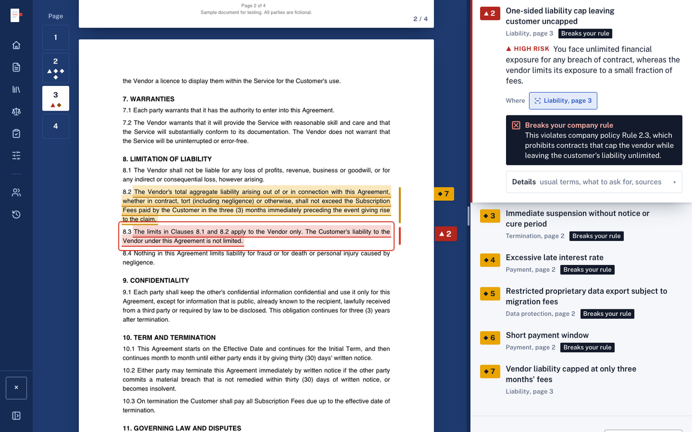 |
| **Citations from a real library.** Malaysian and Singapore statutes and cases, each in plain words, with the provision's text and its official source. | 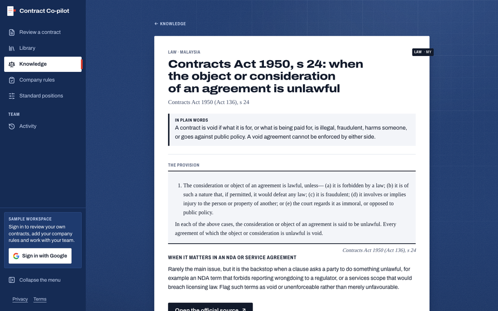 |
| **Dates that matter.** The last day to give notice before a renewal, and other deadlines, collected across your contracts. | 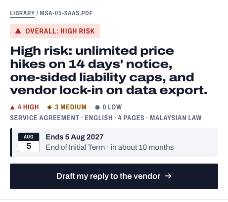 |
| **Search every contract.** Describe the situation in your own words and get the clause and its page. | 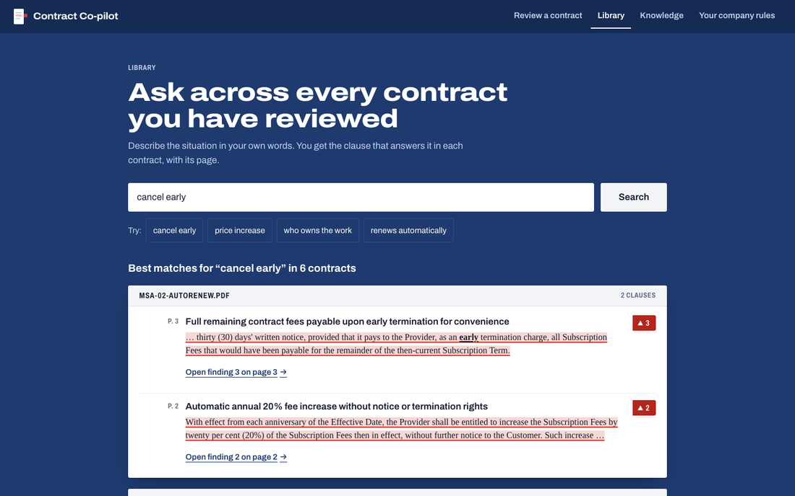 |
| **A team workspace.** Owners, admins and members share contracts, rules and standard positions, with time, cost and risk at a glance. | 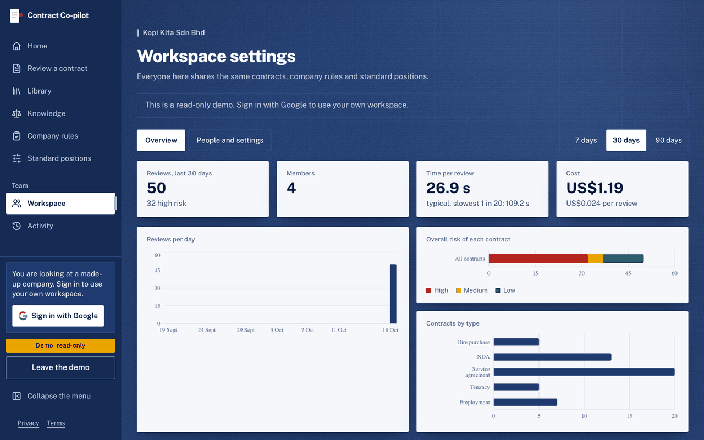 |
| **The X-ray of each review.** Every recorded lookup in the law, usual-terms and company-rules lanes, with its duration. | 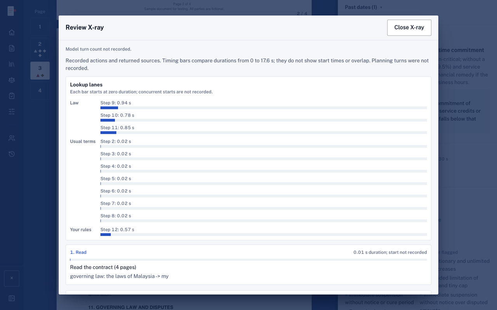 |
| **A reply you control.** Draft an editable response to the other party, with one ask per finding, tied to its clause and page. | <!-- TODO: current-UI capture of a saved synthetic reply; none was reachable read-only on 2026-10-19 --> |

PDFs and scans, English or Bahasa Malaysia, up to 10 MB and 40 pages. New paid work needs Google sign-in and has a
USD 1 allowance per account per UTC day ([details](docs/public/details.md#the-daily-allowance)).

## How it works

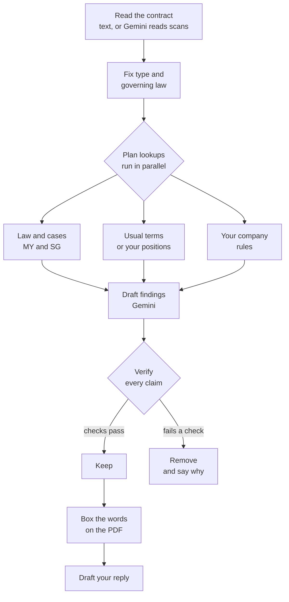

Two model turns and at most 16 lookups per review; the first turn plans every lookup so they run in parallel.
A finding is shown only if its quote is on the page it names; a citation only if it comes from the law library,
copied from the source, in the contract's governing law. These checks constrain the output; they do not prove every
interpretation is correct ([verification rules](docs/public/details.md#verification-rules)).

## Measured results

The stored run of [18 October 2026](eval/results/20261018T124253Z.md) used `gemini-3.8-flash` on 25 synthetic
contracts with hand-written answer keys.

| Measure | That run |
|---|---|
| Expected issues found | **70 of 76 (92%)**: 49 of 54 high-risk, 21 of 22 medium |
| False highs against the answer key | 0 |
| Completed / errored reviews | 25 / 0 |
| Median / slowest review | 36.0 s / 160.2 s |
| Mean model cost per review | USD 0.02657, excluding embeddings |

<p align="center">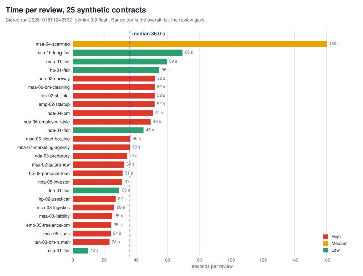</p>

- **Every claim is checked before you see it.** Quotes must be on the stated page, citations must come from the law
  library and support the claim, and dates are computed from the contract's own words. A claim that fails is removed
  and the review says why.
- **What we are still improving.** An independent review of eight outputs scored coverage 8.0/10 and usefulness 7.75/10.
  It found some citations broader than their source supports and some severities higher than needed; general fixes for
  both are in, and a re-run of the same eight found 27 of 29 expected issues with no false highs.
- **These are synthetic contracts**, not a guarantee for real ones. Scans can take over two minutes.

All figures, caveats and raw artifacts: [evaluation details](docs/public/details.md#evaluation).

## Coverage

| Contract type | Standard-terms notes | Sample contracts | Of which Bahasa Malaysia |
|---|---|---|---|
| NDA | 10 | 6 | 1 |
| Service agreement | 12 | 10 | 1 |
| Employment and freelance | 11 | 3 | 1 |
| Tenancy | 10 | 3 | 1 |
| Hire purchase | 10 | 3 | 0 |
| **Total** | **53** | **25** | **4** |

**Law library:** 96 entries with source URLs: Malaysia 40 statutes and 2 cases, Singapore 38 statutes and 16 cases.
Adding a contract type is mostly content ([roadmap](docs/public/roadmap.md)).

## Architecture

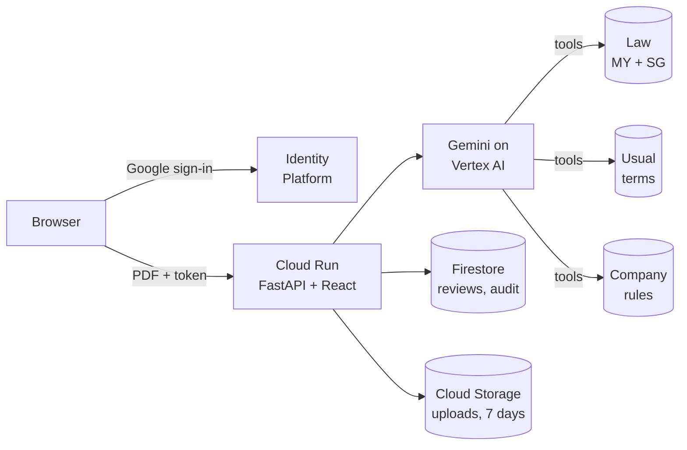

| Layer | Google Cloud |
|---|---|
| Model | Gemini 3.8 Flash on Vertex AI (global endpoint); `gemini-embedding-2` for search |
| App | Cloud Run: scales to zero, at most 3 instances |
| Data | Firestore with vector search; Cloud Storage with a 7-day lifecycle on uploads |
| Sign-in | Google Cloud Identity Platform, Google as the only provider |
| Operations | Cloud Monitoring alerts (5xx rate, latency, uptime check), a Cloud Billing budget, labels on every resource |
| Infrastructure as code | Pulumi (Python) in [`infrastructure/gcp`](infrastructure/gcp): bootstrap script, `foundation` stack, `app` stack |

Cloud services sit behind adapters, so the review logic imports no cloud SDK and tests run offline
([architecture notes](docs/public/details.md#architecture-notes), [repository layout](docs/public/details.md#repository-layout)).

## Run it locally

Install Python 3.12+, [uv](https://docs.astral.sh/uv/) and Node.js with npm, then run the offline tests and the API:

```bash
cd services/api
uv sync
CLOUD=local LLM=fake uv run pytest -q
CLOUD=local LLM=fake uv run uvicorn --factory app.main:create_app --reload --port 8000
```

In a second terminal, from the repository root:

```bash
cd web
npm ci
VITE_API_PROXY=http://localhost:8000 npm run dev   # http://localhost:5173
```

Real reviews use application-default credentials with Vertex AI access, and make paid model calls:

```bash
cd services/api
CLOUD=local LLM=vertex uv run python ../../scripts/review.py ../../samples/contracts/msa-02-autorenew.pdf
CLOUD=local LLM=vertex uv run python ../../scripts/eval.py
```

Test tokens and local sign-in: [local development](docs/public/details.md#local-development).

## Deploy

```bash
bash infrastructure/gcp/bootstrap.sh              # project, billing link, state bucket
source infrastructure/gcp/env.sh
(cd infrastructure/gcp/foundation && pulumi up)   # APIs, IAM, registry, budget, alerts
bash scripts/deploy.sh                            # build, pulumi up app, health check
```

Sign-in needs `googleClientId` and `googleClientSecret` in the `app` stack config; administrators go in the secret
`adminEmails`. `scripts/ingest_knowledge.py --target gcp` indexes the knowledge; `scripts/teardown.sh` removes it all.

## Data and licences

- Every sample contract and the sample company policy is synthetic: invented companies, no real people.
- The law library quotes official sources (Laws of Malaysia, Singapore Statutes Online, eLitigation); terms in
  [`knowledge/law/README.md`](knowledge/law/README.md) and [`knowledge/playbook/SOURCES.md`](knowledge/playbook/SOURCES.md).
- Images are live, read-only captures on synthetic data ([provenance](docs/public/details.md#images-in-the-readme)).
- No software licence file yet; until one is added, all rights in the code are reserved.

## Disclaimer

Contract Co-pilot gives general information to help you prepare for a conversation with the other side. It is not
legal advice, and it does not replace a lawyer for a contract that matters.
