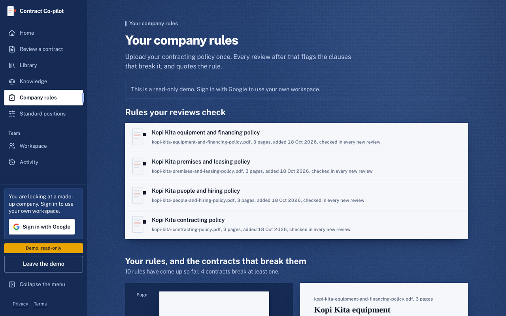
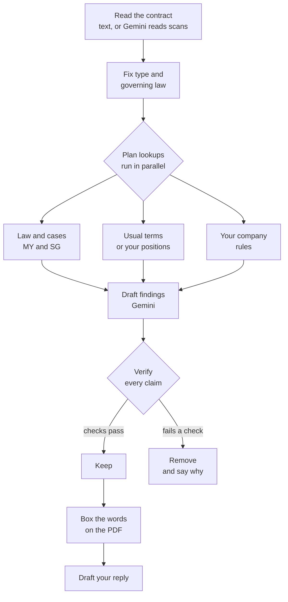
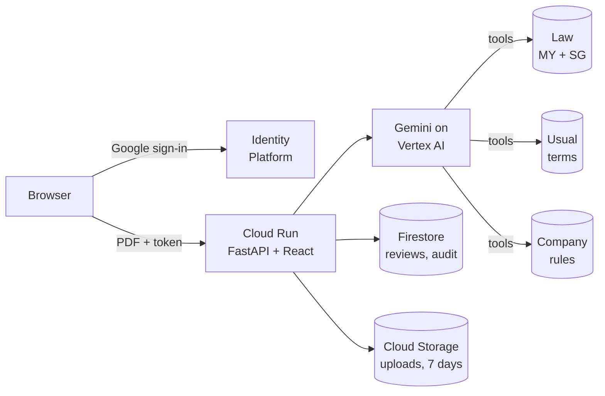

<div align="center">

# Contract Co-pilot

**Know what you're signing, before you sign it.**

Contract Co-pilot reviews the vendor contracts that small businesses in Malaysia and Singapore sign without a lawyer.
Read the contract’s own pages beside quoted findings, the sources used to check them, your company’s rules,
and a reply you can edit before sending. Covers NDAs, service agreements, employment and freelance, tenancy,
and hire purchase under Malaysian or Singapore law.

[](https://cloud.google.com)
[](https://cloud.google.com/vertex-ai)
[](https://cloud.google.com/run)
[](https://cloud.google.com/firestore)
[](infrastructure/gcp)
[](services/api)
[](web)

**[Open the live demo](https://contract-copilot-ordg3tjh7a-as.a.run.app)** · built for the Google Cloud **AI Builder Cup 2026**, theme *Future of Work & Enterprise Productivity*

</div>

> Contract Co-pilot gives general information to help you prepare. It is not legal advice.

## See it work

[Open the demo](https://contract-copilot-ordg3tjh7a-as.a.run.app) and choose a sample contract to read its PDF before opening its saved review.
Or open **Workspace → View the read-only demo** to explore the fictional Kopi Kita company’s contracts, rules and people.
No sign-in is needed for cached sample reviews, saved replies, keyword search or the law library.

[Watch the recorded product demo](https://drive.google.com/file/d/1KztL52YcRw1_XKTOd6A3fr5pkWpoL8yx/view).
The recording shows an earlier interface; the current app may look different.

<p align="center"></p>

| | |
|---|---|
|  |  |
| The contract beside its findings | The X-ray of the recorded lookups |
|  |  |
| Company rules beside the policy PDF | The read-only demo workspace |

These were captured from the live service on synthetic contracts and an invented company; how each was made is in
[`docs/public/media.md`](docs/public/media.md). Opening a saved sample does not run a new review.

## What you get

- **The contract beside the findings.** Read the actual PDF, select a finding and see its quoted words boxed on the page. Short summaries open into the explanation, suggested change and cited sources.
- **Progress reported by the server.** Fresh reviews report reading, planning, research, drafting, verification and locating phases as they happen. Older servers show an honest waiting state; opening a cached result is labelled separately.
- **Your company’s rules.** Owners and admins can upload policies and edit standard positions. Findings quote the relevant rule; the evidence view puts the contract and policy pages side by side.
- **A reply you control.** Draft an editable response to the employer, landlord, lender, vendor or other party, with asks tied to the findings. New drafts need sign-in; visitors and guests can only open an already saved reply.
- **A shared contract library.** Search clauses and their pages, track upcoming dates, and review activity and earlier runs. Signed-in search combines meaning and keywords; public search uses keywords.

PDFs and JPG/PNG scans are supported, in English or Bahasa Malaysia, up to 10 MB and 40 pages.
The upload queue reviews files one at a time. Before adding them, choose the contract type, governing law,
company policies and whether the review represents your business or you personally; automatic choices are available.

### Accounts and trust

Google sign-in creates a personal or company workspace, with owner, admin and member roles.
Reviews, policies and search are scoped to that workspace. Owners and admins manage people, rules and standard positions;
review history and an audit trail keep the recorded provenance. You can delete a review or the data you own.

The demo company contains synthetic contracts and invented people. Guests can browse its overview, people, rules and
activity, but cannot upload, edit, delete or start new paid work. A saved reply must already exist; an uncached reply
request requires sign-in. There is no guest bypass for a cold instance or a missing saved draft.

New paid work requires sign-in and has a **USD 1 allowance per account per UTC day**, including model attempts,
retries, fallback models, embeddings and policy processing. The service reserves a bounded amount before an attempt;
known usage releases unused allowance. A call that clearly returned nothing (timeout, overload) keeps only its input cost, at most 20 times per account per day; any other uncertain failure keeps the whole reservation. This is conservative token-price
accounting, not an exact provider invoice. Cached reads do not start new AI calls.

**Limits to keep in mind.** Finding the quoted text and checking that a source exists do not prove the legal interpretation
or risk rating is correct. The prototype can miss issues or make unsupported claims; verify the cited words and consult a
lawyer when needed. Scans can take longer than text PDFs. A completed review is saved to the Library, but refreshing or
closing an active review does not have a durable background-resume guarantee; a pending upload queue depends on its page.

## How it works



The verify step keeps a claim only if its quote is on the stated page, its citation is in the library and supports
the claim, its law is the locked jurisdiction, and any date or amount it states appears in the contract.
If Gemini 3.8 Flash stalls, the same request is retried once on Gemini 3.5 Flash.

The loop is bounded: two model turns and at most 16 lookups per review. The first turn plans every lookup at once, so they run
side by side instead of one after another.

**Three rules decide what you see.** A finding is shown only if its quote is found on the page it names. A citation is shown only
if it comes from the knowledge library, with its text copied from the source and never written by the model. And the law cited
is that of the contract's governing jurisdiction: it is fixed once, early in the review, and a citation from the other
jurisdiction is removed. Unsupported claims are recorded with reasons when removed. A high-risk rating whose consequence cannot be verified
may instead be reduced to medium while the finding is kept; the review distinguishes these adjustments from removals.
These checks constrain the output, but do not establish that every retained interpretation is correct.

Matching a quote is tolerant of how PDFs store text, not of what the contract says. Both sides are reduced to letters and digits,
ligatures and curly quotes are folded, hyphenated line breaks are rejoined and page furniture (page numbers, running headers and
footers) is ignored. A close-but-not-exact match is accepted only if it has the same numbers and the same negations as the quote,
so a changed figure or a dropped "not" is removed.

## Measured results

The stored run **[18 October 2026, 12:42:53 UTC](eval/results/20261018T124253Z.md)** used `gemini-3.8-flash`
on 25 synthetic contracts with hand-written answer keys. These are results for that artifact, not a guarantee for the
current deployment or real contracts. [Raw results and outputs](eval/results/20261018T124253Z.json) are available for inspection.

| Measure | That run |
|---|---|
| Expected issues found | 70 of 76 (92%); 49/54 high, 21/22 medium |
| False highs against the answer key’s excluded high-risk clause types | 0 |
| Completed / errored reviews | 25 / 0 |
| Median / slowest review | 36.0 s / 160.2 s |
| Mean model cost per review | USD 0.02657, excluding embeddings |

A later **[fixed eight-case validation](eval/results/20261018T152353Z.md)** on backend `88801f2` found 28 of 29
expected issues, with no answer-key false highs. Its median / slowest review was 37.4 s / 131.0 s; the mean successful
model-call estimate was USD 0.02873, excluding embeddings. This is a smaller, separate scope, combined from two sequential
runs; [the raw artifact](eval/results/20261018T152353Z.json) preserves the initial budget-blocked attempts and provenance.
It does not replace the 25-case benchmark or establish real-world accuracy. The product’s USD 1 daily allowance is unchanged.

**Recall is not overall quality.** The completed assessment of these same eight fresh outputs is **FAIL**:
citation support averaged **6.875/10** and restraint **6.375/10**, both below the required 7. Other scored averages met
that threshold, but they do not offset these failures or establish that individual findings are correct. Email-draft
quality is **not assessed (N/A): zero drafts were tested**. Zero false highs against a limited answer key does not
establish that every finding or severity is correct. Both dated runs include a scanned contract taking longer than
two minutes; no universal speed or near-zero-cost promise is made.

[Earlier runs](eval/results) remain available. Running `scripts/eval.py` makes paid model calls; reproduce it only with
configured access and an explicit budget.

## Coverage

| Contract type | Standard-terms notes | Sample contracts | Of which Bahasa Malaysia |
|---|---|---|---|
| NDA | 10 | 6 | 1 |
| Service agreement | 12 | 10 | 1 |
| Employment and freelance | 11 | 3 | 1 |
| Tenancy | 10 | 3 | 1 |
| Hire purchase | 10 | 3 | 0 |
| **Total** | **53** | **25** | **4** |

**Jurisdictions:** Malaysia and Singapore. The review picks one from the governing-law clause.

**Law library:** 96 entries, each with its source URL.

| | Statutes | Cases | Total |
|---|---|---|---|
| Malaysia | 40 | 2 | 42 |
| Singapore | 38 | 16 | 54 |

Contract types are packs: a set of standard terms, the relevant law, and samples with answer keys. The reader, the verification
and the reply are shared, so adding a type is mostly content. See [`docs/public/roadmap.md`](docs/public/roadmap.md).

## Architecture



Cloud services sit behind adapters selected by configuration. The review logic imports no cloud SDK, and local adapters
let tests run without model or cloud calls. Fresh review responses can stream reported phases over the existing request;
this is not a durable background-job system.

| Layer | Google Cloud |
|---|---|
| Model | Gemini 3.8 Flash on Vertex AI (global endpoint); `gemini-embedding-2` for search |
| App | Cloud Run: scales to zero, at most 3 instances |
| Data | Firestore with vector search (reviews, search chunks, company policies, workspaces and members, invites, users, audit events, the knowledge library, standard-position overrides); Cloud Storage with a 7-day lifecycle on uploads |
| Sign-in | Google Cloud Identity Platform (Google as the only provider); the API verifies each ID token and serves the web client config at `/api/auth/config` |
| Operations | Cloud Monitoring alerts (5xx rate, latency, uptime check), a Cloud Billing budget, labels on every resource |
| Infrastructure as code | Pulumi (Python) in [`infrastructure/gcp`](infrastructure/gcp): bootstrap script, `foundation` stack, `app` stack |

Alongside the per-account allowance, fresh reviews have per-address and per-user rate limits and a service-wide daily
review-count cap. The count cap covers reviews; the account allowance also covers other paid work such as drafts and
embeddings. Cached results and copies do not start a new model review. Accounting failures refuse new paid work rather
than bypassing the allowance.

## Repository layout

```
services/api/        Python backend: pipeline, review loop, adapters (GCP and local), tests
web/                 React + TypeScript frontend
shared/contracts/    JSON Schema for the API, the single source of truth for api and web
knowledge/law/       Malaysian and Singapore statutes and cases, each with its source URL
knowledge/playbook/  standard terms per clause type, for each contract type
samples/             synthetic contracts with answer keys, plus a sample company policy
samples/showcase/    30 synthetic contracts for the demo company
eval/results/        measured evaluation runs
infrastructure/gcp/  Pulumi stacks
scripts/             review, eval, seed, deploy, teardown
docs/public/         images for this README, and the roadmap
```

## Run it locally

Install Python 3.12+, [uv](https://docs.astral.sh/uv/) and Node.js with npm, then run the offline tests:

```bash
cd services/api
uv sync
CLOUD=local LLM=fake uv run pytest -q
```

Start the local API in that terminal:

```bash
CLOUD=local LLM=fake uv run uvicorn --factory app.main:create_app --reload --port 8000
```

In a second terminal, from the repository root:

```bash
cd web
npm ci
VITE_API_PROXY=http://localhost:8000 npm run dev   # http://localhost:5173
```

The fake model is for exercising the interface and tests, not evaluating review quality. Real reviews need Google Cloud
application-default credentials with Vertex AI access and `LLM=vertex`. `CLOUD=local` accepts test tokens
(`Authorization: Bearer test:<uid>:<email>`, optionally `:hd=<domain>`); deployed services reject them.
The normal Google sign-in flow needs Identity Platform configured, so a fresh local browser is not signed in automatically.

For a real, paid single-file review or evaluation:

```bash
cd services/api
CLOUD=local LLM=vertex uv run python ../../scripts/review.py ../../samples/contracts/msa-02-autorenew.pdf
CLOUD=local LLM=vertex uv run python ../../scripts/eval.py
```

## Deploy

```bash
bash infrastructure/gcp/bootstrap.sh              # project, billing link, state bucket
source infrastructure/gcp/env.sh
(cd infrastructure/gcp/foundation && pulumi up)   # APIs, IAM, registry, budget, alerts
bash scripts/deploy.sh                            # build, pulumi up app, health check
```

Google sign-in switches on once the Google OAuth client id and secret are set in the `app` stack config (`googleClientId`,
`googleClientSecret`); platform administrators are listed in the secret config `adminEmails`. `scripts/ingest_knowledge.py
--target gcp` indexes the law and playbook into Firestore. `scripts/teardown.sh` removes what the deploy created.

## Data and licences

- Every sample contract and the sample company policy is synthetic: invented companies, no real people.
- The law library quotes official sources (Laws of Malaysia, Singapore Statutes Online, eLitigation). The source and reuse terms
  of each entry are listed in [`knowledge/law/README.md`](knowledge/law/README.md); playbook sources are in
  [`knowledge/playbook/SOURCES.md`](knowledge/playbook/SOURCES.md).
- This repository does not yet include a software licence file. Until one is added, all rights in the code are reserved.

## Disclaimer

Contract Co-pilot gives general information to help you prepare for a conversation with the other side. It is not legal advice,
and it does not replace a lawyer for a contract that matters.
